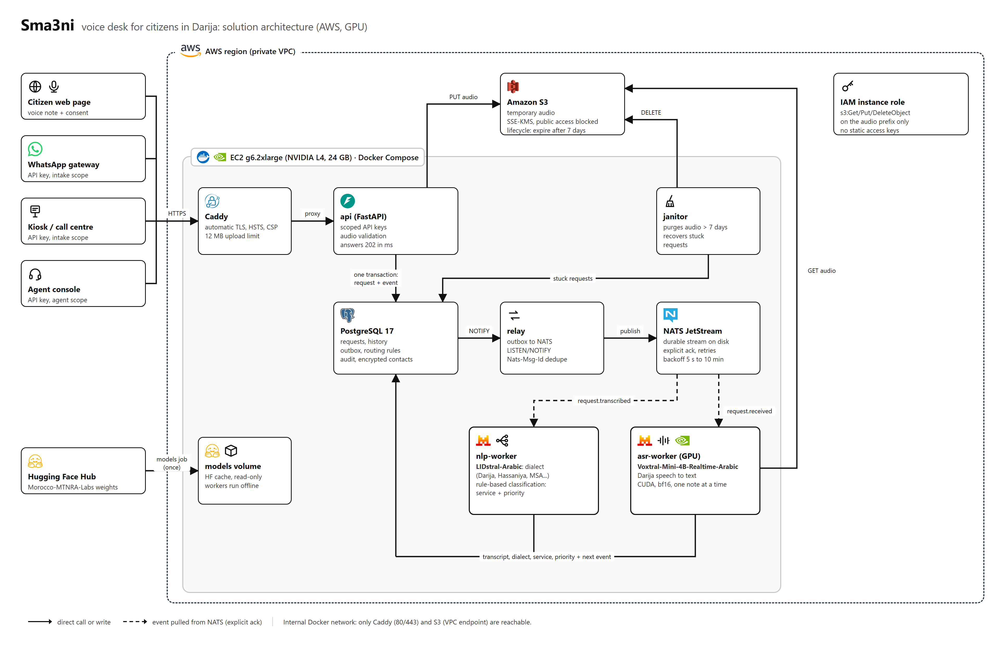
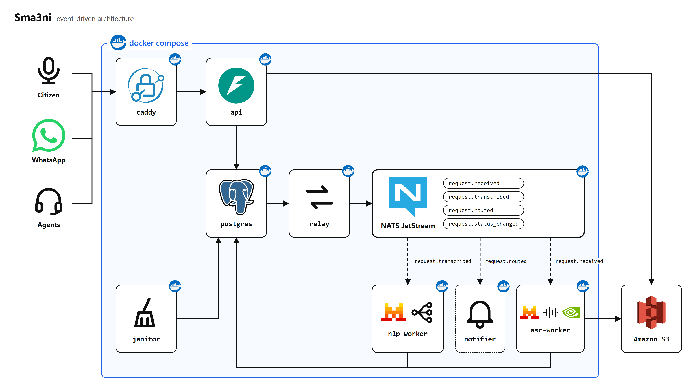

# Sma3ni

Sma3ni ("listen to me" in Moroccan Darija) is a voice-first request desk for public services.
A citizen sends a voice note in Darija; the administration receives a written, classified request
routed to the right department, and the citizen gets a tracking code.

It is built on two open models from Morocco-MTNRA-Labs:

- **Voxtral-Mini-4B-Realtime-Arabic** for speech-to-text (Darija, Hassaniya, MSA, French code-switching)
- **LIDstral-Arabic** for dialect identification



## How it works

1. A channel (citizen web page, WhatsApp gateway, kiosk, call centre) uploads a voice note to the API.
2. The API validates the audio, stores it (Amazon S3 or a local volume), writes the request and a
   `request.received` event to PostgreSQL in one transaction, and answers `202` with a tracking code.
3. A relay publishes outbox events to NATS JetStream.
4. `asr-worker` transcribes the note on the GPU and emits `request.transcribed`.
5. `nlp-worker` identifies the dialect, applies the routing rules stored in PostgreSQL, sets the
   service and priority, and emits `request.routed`. Uncertain cases go to a human triage desk.
6. Agents work their queue in the agent console; the citizen follows the request with the tracking code.



## Quick start (laptop, no models)

Requirements: Docker with Compose v2.

```bash
cp .env.example .env            # fill POSTGRES_PASSWORD, NATS_PASSWORD, CONTACT_ENC_KEY
docker compose -f docker-compose.yml -f docker-compose.dev.yml up -d --build
./scripts/smoke.sh              # end-to-end: upload, transcribe (fake), route -> SMOKE OK
```

The dev overlay replaces both models with deterministic fakes, so the whole pipeline runs on a CPU
laptop. Citizen page: http://localhost:8000, agent console: http://localhost:8000/agent,
OpenAPI docs: http://localhost:8000/docs.

Unit tests:

```bash
pip install -r requirements/dev.txt
ruff check . && pytest
```

## Production on AWS (GPU + S3)

```bash
cd deploy/aws/terraform && terraform init && terraform apply     # bucket, IAM role, GPU instance
# on the instance (aws ssm start-session --target <instance_id>):
git clone https://github.com/aliamrrr/sma3ni.git && cd sma3ni
cp .env.example .env && chmod 600 .env                           # secrets + `terraform output env_lines`
export COMPOSE_FILE=docker-compose.yml:docker-compose.aws.yml
docker compose build && docker compose run --rm models && docker compose up -d
```

Step-by-step instructions, sizing and operations are in [docs/TECHNICAL.md](docs/TECHNICAL.md).

## Repository layout

| Path | Content |
|---|---|
| `sma3ni/api` | FastAPI app: intake, citizen tracking, agent endpoints, API key auth |
| `sma3ni/workers` | JetStream consumers: `asr` (Voxtral) and `nlp` (LIDstral + routing) |
| `sma3ni/engines` | Model wrappers, with fake engines for development |
| `sma3ni/storage.py` | Audio storage: local volume or Amazon S3 |
| `sma3ni/relay.py`, `events.py` | Transactional outbox and NATS JetStream setup |
| `sma3ni/routing.py`, `textnorm.py` | Darija/MSA normalisation and keyword routing |
| `sma3ni/web` | Citizen page and agent console (static, no build step) |
| `db/migrations` | SQL schema and seed data (services, routing rules) |
| `docker/`, `docker-compose*.yml` | Images and stacks: base, dev overlay, AWS overlay |
| `deploy/aws` | Terraform (S3, IAM, VPC endpoint, EC2 GPU) and instance bootstrap |
| `docs/` | Technical documentation and diagrams (`docs/diagram/build.py`) |

## Documentation

- [Technical documentation](docs/TECHNICAL.md): architecture, events, data model, API, configuration,
  deployment, security, operations, known limitations
- [Security policy](SECURITY.md)

## Status

Working end to end with the fake engines. The Voxtral inference path follows the model card
(`transformers>=5.2.0`) but has not yet been run against the real weights; validate it on the first
GPU deployment (see "Known limitations" in the technical documentation).

Sma3ni is not an emergency line. Emergencies remain 15, 19 and 150.
