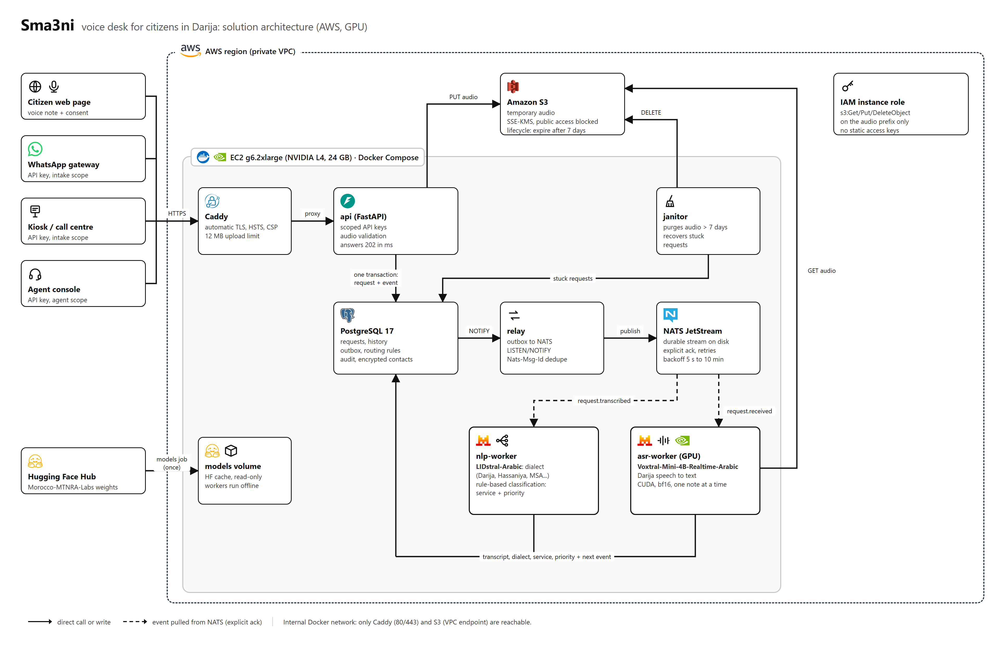
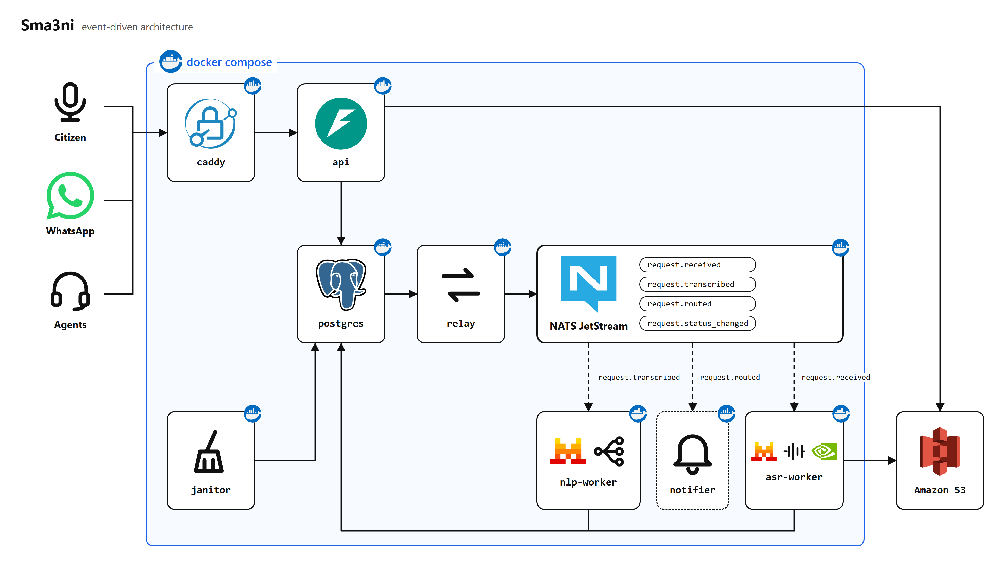

# Sma3ni technical documentation

This document describes how Sma3ni is built, deployed and operated. It is written for engineers who
run or extend the system.

Contents

1. [Context and goals](#1-context-and-goals)
2. [Architecture](#2-architecture)
3. [Request lifecycle](#3-request-lifecycle)
4. [Events and delivery guarantees](#4-events-and-delivery-guarantees)
5. [Models](#5-models)
6. [Routing](#6-routing)
7. [Data model](#7-data-model)
8. [HTTP API](#8-http-api)
9. [Configuration reference](#9-configuration-reference)
10. [Deployment on AWS](#10-deployment-on-aws)
11. [Local development](#11-local-development)
12. [Security](#12-security)
13. [Operations](#13-operations)
14. [Scaling](#14-scaling)
15. [Known limitations](#15-known-limitations)

---

## 1. Context and goals

Moroccan citizens mostly communicate by voice and in Darija (voice notes, phone calls). Administrative
portals expect written Modern Standard Arabic or French, and expect the citizen to pick the right
department. Sma3ni accepts a voice note, transcribes it, identifies the dialect, routes the request to
a department and gives the citizen a tracking code.

Design constraints:

- **Asynchronous by design.** A 4B speech model takes seconds on a GPU and minutes on a CPU. The API
  never waits for a model; it answers `202` in milliseconds and the pipeline runs in the background.
- **A human always gets the request.** Any failure, low-confidence language detection, unsupported
  language or ambiguous category sends the request to the triage desk instead of guessing.
- **Deterministic, auditable routing.** No generative model decides where a request goes. Routing rules
  are rows in PostgreSQL that staff can read and edit.
- **Data minimisation.** Audio is temporary, contacts are encrypted at application level, every read of
  personal data is audited.
- **Small operational footprint.** One server running Docker Compose. Managed services only where they
  remove real work (S3 for audio).

## 2. Architecture





### Containers

| Container | Image | Role | Network |
|---|---|---|---|
| `caddy` | `caddy:2.10-alpine` | TLS termination (Let's Encrypt), security headers, upload size limit | edge |
| `api` | `sma3ni-core` | FastAPI: intake, tracking, agent endpoints, static web pages | edge, backend (+ egress on AWS) |
| `relay` | `sma3ni-core` | Publishes the PostgreSQL outbox to NATS JetStream | backend |
| `asr-worker` | `sma3ni-ml` | Consumes `request.received`, runs Voxtral, writes the transcript | backend (+ egress on AWS) |
| `nlp-worker` | `sma3ni-ml` | Consumes `request.transcribed`, runs LIDstral and routing | backend |
| `janitor` | `sma3ni-core` | Audio retention, recovery of stuck requests, table trimming | backend (+ egress on AWS) |
| `postgres` | `postgres:17-alpine` | System of record: requests, history, outbox, rules, audit | backend |
| `nats` | `nats:2.11-alpine` | JetStream: durable event stream on disk | backend |
| `migrate` | `sma3ni-core` | One-shot: applies `db/migrations/*.sql` (advisory-locked) | backend |
| `models` | `sma3ni-ml` | One-shot: downloads model weights into the `models` volume | egress |

The `backend` network is `internal: true`: PostgreSQL, NATS and the workers have no route to the
internet. On AWS, the services that need S3 also join `egress`; outbound traffic is then limited by the
instance security group to ports 80 and 443, and S3 traffic goes through the VPC gateway endpoint.

### Images

- `docker/core.Dockerfile`: Python 3.12 slim, API and infrastructure processes, no ML dependencies.
- `docker/ml.Dockerfile`: adds ffmpeg, PyTorch and Transformers. The `TORCH_INDEX` build argument
  selects CPU wheels (default) or CUDA 12.8 wheels (set by `docker-compose.aws.yml`).

Both images run as an unprivileged user (uid 10001). Every application container runs with a read-only
root filesystem, `cap_drop: ALL`, `no-new-privileges`, CPU and memory limits, and rotated JSON logs.

### Compose files

| File | Use |
|---|---|
| `docker-compose.yml` | Base stack, local audio volume, CPU inference |
| `docker-compose.dev.yml` | Laptop overlay: fake ASR/LID engines, API on `127.0.0.1:8000`, no Caddy |
| `docker-compose.aws.yml` | AWS overlay: S3 storage, CUDA image, GPU reservation for `asr-worker` |

## 3. Request lifecycle

```
RECEIVED -> TRANSCRIBING -> TRANSCRIBED -> ROUTED -> IN_PROGRESS -> RESOLVED
                                              |            \-------> REJECTED
any pipeline status -----------------------> FAILED (handed to triage, an agent can take it over)
```

| Step | Component | Writes |
|---|---|---|
| Upload | `api` | audio object, `requests` row (`RECEIVED`), history row, `request.received` outbox row |
| Transcription | `asr-worker` | `TRANSCRIBING`, then transcript, duration, model, `TRANSCRIBED`, `request.transcribed` |
| Routing | `nlp-worker` | dialect label and confidence, category, service, priority, review flags, `ROUTED`, `request.routed` |
| Handling | agent via `api` | `IN_PROGRESS` / `RESOLVED` / `REJECTED`, reassignment, `request.status_changed` |
| Retention | `janitor` | deletes audio after `AUDIO_RETENTION_DAYS`, sets `audio_purged_at` |

Status changes go through `repo.set_status`, an atomic compare-and-set that also writes
`request_history`. A worker only moves a request from the status it expects, so a late or duplicate
delivery cannot overwrite a newer state or an agent's decision.

The citizen sees a simplified, bilingual (French / Darija) status through `GET /v1/track/{code}`.
`FAILED` is shown as "waiting for an agent", because a failed request is handled by a human, not lost.

## 4. Events and delivery guarantees

| Event | Producer | Consumer |
|---|---|---|
| `request.received` | api | asr-worker |
| `request.transcribed` | asr-worker | nlp-worker |
| `request.routed` | nlp-worker | none yet (planned: citizen notifications, webhooks) |
| `request.failed` | workers, janitor | none yet (planned: alerting) |
| `request.status_changed` | api | none yet (planned: citizen notifications) |

Subjects are `sma3ni.<event>` in the JetStream stream `SMA3NI` (file storage, 7-day retention,
2-minute duplicate window). Envelope:

```json
{"type": "request.received", "request_id": "uuid", "data": {}, "id": "uuid",
 "occurred_at": "2026-11-07T21:00:00+00:00", "version": 1}
```

**Transactional outbox.** A state change and its event are written in the same PostgreSQL transaction
(`events.emit`). There is no window where the database is updated but the event is lost, or the
reverse. A trigger sends `NOTIFY outbox`; the relay wakes up, selects pending rows with
`FOR UPDATE SKIP LOCKED`, publishes them and marks them published. A 1-second poll covers missed
notifications.

**Broker-side deduplication.** The relay sets `Nats-Msg-Id` to the event id. If it crashes after
publishing but before committing, the re-publish is dropped by JetStream.

**Consumer-side deduplication.** Each worker records `(consumer, event_id)` in `processed_events` in the
same transaction as its own writes. A redelivered event that was already applied is skipped. Together:
exactly-once effects on top of at-least-once delivery.

**Retries.** Workers use durable pull consumers with explicit ack. Long jobs call `in_progress()` to
extend the ack deadline. Transient errors are negatively acknowledged with a backoff of 5 s, 30 s,
2 min, 10 min. Permanent errors (undecodable audio, too long, missing object) or the last attempt mark
the request `FAILED`, assign it to `triage` and emit `request.failed`. A process that dies mid-job
(out of memory) is detected by the delivery count on the next attempt.

**Adding a consumer.** Subclass `workers.base.BaseWorker`, set `consumer` (durable name) and
`event_type`, implement `handle`. Because the stream uses limits-based retention, a new consumer can
replay the last 7 days of events.

## 5. Models

| | ASR | Language identification |
|---|---|---|
| Model | `Morocco-MTNRA-Labs/Voxtral-Mini-4B-Realtime-Arabic` | `Morocco-MTNRA-Labs/LIDstral-Arabic` |
| Code | `sma3ni/engines/asr.py` | `sma3ni/engines/lid.py` |
| Runtime | Transformers, bf16, CUDA on AWS (CPU possible) | fastText + MLP + isotonic calibration, CPU |
| Input | whole voice note, decoded by ffmpeg to 16 kHz mono float32 | transcript text |
| Output | text, duration | label, confidence |

Weights are downloaded once by the `models` job into the `models` volume. Workers start with
`HF_HUB_OFFLINE=1`; a Hugging Face outage never blocks a restart. `consolidated.safetensors` (the vLLM
copy of the Voxtral weights) is skipped, which saves about 9 GB.

`ASR_DEVICE=cuda` makes the worker refuse to start if no GPU is visible, rather than silently running
10 to 50 times slower on CPU.

LIDstral ships its own loader (`classify.py`) and a pickled calibrator: this is code from the model
repository, executed in the worker. Pin `LID_REVISION` (and `ASR_REVISION`) to reviewed commits.

## 6. Routing

`sma3ni/routing.py` and `sma3ni/textnorm.py`, pure standard library, fully unit-tested.

**Normalisation.** Unicode NFKD, removal of diacritics and hamza seats, unification of Arabic letter
variants (ta marbuta, alef maqsura, Moroccan gaf, veh, peh), lowercasing, punctuation removal. Arabic
tokens also match without their proclitics (`و`, `ب`, `ف`, `ل`, `ال` and combinations) as long as the
stem keeps at least 3 letters, so `الما` (water) never becomes `ما` (negation). French plurals match
their singular.

**Rules.** Each row of `routing_rules` has a category, a target service, a priority (1 = urgent) and a
list of keywords in Darija, MSA or French. A keyword matches when its tokens appear consecutively.
The rule with the most matched keywords wins, then the most urgent, then the oldest. Any urgent match
escalates the priority (a corruption report mentioning a building permit stays priority 1).

**Language gate.** LIDstral labels are mapped to families (`darija`, `hassaniya`, `msa`,
`arabic_other`, `amazigh`, `other`). The request is flagged for review when the confidence is below
`LID_MIN_CONFIDENCE`, when the family is not covered by the Arabic ASR (Amazigh), when the transcript
is empty, when no rule matches (service `triage`) or when two categories tie.

**Editing rules in production.** The nlp-worker reloads rules every 60 seconds:

```sql
UPDATE routing_rules SET keywords = array_append(keywords, 'لاكريم') WHERE category = 'eau_electricite';
```

## 7. Data model

Defined in `db/migrations/`. Migrations run once each, in file order, under an advisory lock.

| Table | Content |
|---|---|
| `services` | Departments (code, French and Arabic names). `triage` is the human fallback desk. |
| `routing_rules` | Category, target service, keywords, priority, enabled flag |
| `api_keys` | Name, SHA-256 hash of the key, scopes, optional service restriction, revocation |
| `requests` | One row per voice note: status, channel, region, encrypted contact, audio metadata, transcript, dialect, routing decision, review flags, failure reason |
| `request_history` | Every status change with actor and note |
| `audit_log` | Every read of a request or its audio, with the API key that read it |
| `outbox` | Events waiting for (or done with) publication |
| `processed_events` | Consumer-side deduplication |
| `schema_migrations` | Applied migration files |

Audio is not stored in PostgreSQL. `requests.audio_key` points to `YYYY/MM/DD/<uuid>.<ext>` in the
storage backend; `audio_sha256` and `audio_bytes` allow integrity checks.

## 8. HTTP API

Authentication: `Authorization: Bearer sk_sma3ni_...`. Keys have scopes `intake`, `agent`, `admin`
(admin implies all) and an agent key can be restricted to one service.

| Method | Path | Scope | Description |
|---|---|---|---|
| `POST` | `/v1/requests` | intake | Multipart: `audio`, `channel` (`web`, `whatsapp`, `call_center`, `kiosk`, `mobile`), optional `contact`, `region`. Optional `Idempotency-Key` header. Returns `202 {id, tracking_code, status, track_url}`, or `200` with the original request on replay. |
| `POST` | `/v1/public/requests` | none | Citizen web page. Requires `consent=true`, limited to `PUBLIC_HOURLY_LIMIT` requests per client per hour. |
| `GET` | `/v1/track/{code}` | none | Citizen status in French and Darija, department once routed. No transcript, no contact, no internal id. |
| `GET` | `/v1/me` | any | Name, scopes and service of the calling key |
| `GET` | `/v1/services` | agent | List of departments |
| `GET` | `/v1/requests` | agent | Queue. Filters `status`, `service`, `needs_review`; cursor pagination with `before`; `limit` up to 200 |
| `GET` | `/v1/requests/{id}` | agent | Full request, decrypted contact, history. Audited. |
| `GET` | `/v1/requests/{id}/audio` | agent | Original audio. Audited. `410` once purged. |
| `PATCH` | `/v1/requests/{id}` | agent | `status` (`IN_PROGRESS`, `RESOLVED`, `REJECTED`), `service_code` (reassignment, triage or unrestricted keys only), `note` |
| `GET` | `/v1/admin/stats` | admin | Counts by status, outbox backlog, review queue, last 24 hours |
| `GET` | `/healthz`, `/readyz` | none | Liveness and readiness (blocked at Caddy, used by Docker) |

Upload validation: size limit at Caddy (12 MB) and in the API (`MAX_UPLOAD_MB`), format detected from
magic bytes (OGG/Opus, WAV, MP3, M4A, WebM, FLAC, AMR; the client `Content-Type` is ignored), duration
limit (`MAX_AUDIO_SECONDS`) enforced after decoding, ffmpeg run under a timeout.

Error codes: `401` bad key, `403` missing scope, `404` unknown or not visible (same answer for both, so
no existence oracle), `409` invalid transition, `410` audio purged, `413` too large, `415` unsupported
format, `429` rate limited, `503` storage or database unavailable.

API keys are managed with the CLI:

```bash
docker compose run --rm api python -m sma3ni.cli create-key --name whatsapp-gateway --scopes intake
docker compose run --rm api python -m sma3ni.cli create-key --name triage --scopes agent --service triage
docker compose run --rm api python -m sma3ni.cli list-keys
docker compose run --rm api python -m sma3ni.cli revoke-key <key-id>
```

The raw key is printed once and only its hash is stored.

## 9. Configuration reference

All settings are environment variables, read in `sma3ni/config.py`. Secrets also accept a `<NAME>_FILE`
variant pointing to a file (Docker secrets).

| Variable | Default | Description |
|---|---|---|
| `DOMAIN`, `ACME_EMAIL` | | Public hostname and Let's Encrypt contact (Caddy) |
| `POSTGRES_PASSWORD` | required | Database password |
| `NATS_PASSWORD` | required | NATS password |
| `CONTACT_ENC_KEY` | required | Fernet key(s), comma-separated for rotation (`new,old`). Also derives the key used to hash client IPs. |
| `STORAGE_BACKEND` | `local` | `local` or `s3` (`s3` is set by the AWS overlay) |
| `STORAGE_DIR` | `/data/audio` | Local backend directory |
| `S3_BUCKET` | | Bucket name (Terraform output) |
| `S3_PREFIX` | `audio` | Key prefix; must match the IAM policy and lifecycle rule |
| `AWS_REGION` | | Bucket region |
| `S3_SSE` | `aws:kms` | Server-side encryption header: `aws:kms`, `AES256`, or empty |
| `S3_KMS_KEY_ID` | | Customer-managed KMS key (optional) |
| `S3_ENDPOINT_URL` | | S3-compatible store (MinIO). Leave empty on AWS. |
| `ASR_ENGINE` / `LID_ENGINE` | `voxtral` / `lidstral` | `fake` for development |
| `ASR_MODEL_ID`, `LID_MODEL_ID` | MTNRA models | Hugging Face repositories |
| `ASR_REVISION`, `LID_REVISION` | | Pinned commits (recommended in production) |
| `ASR_DEVICE` | `cpu` | `cuda` on GPU instances (set by the AWS overlay) |
| `ASR_DTYPE` | `bfloat16` | Model precision |
| `ASR_THREADS` | CPU count | PyTorch CPU threads |
| `ASR_MEM_LIMIT` | `14g` (`20g` on AWS) | Container memory limit of `asr-worker` |
| `HF_TOKEN` | | Only for gated or private model repositories |
| `LID_MIN_CONFIDENCE` | `0.5` | Below this, the request is flagged for review |
| `AUDIO_RETENTION_DAYS` | `7` | Audio deletion delay |
| `MAX_UPLOAD_MB` / `MAX_AUDIO_SECONDS` | `10` / `180` | Upload limits |
| `PUBLIC_HOURLY_LIMIT` | `5` | Citizen web submissions per client per hour |
| `API_WORKERS` | `2` | Uvicorn worker processes |
| `PG_SHARED_BUFFERS` | `1GB` | PostgreSQL shared buffers |
| `EXPOSE_DOCS` | `false` | Serve `/docs` and `/openapi.json` |
| `LOG_LEVEL` | `INFO` | JSON logs on stdout |

AWS credentials are never configured in `.env`. On EC2, boto3 obtains temporary credentials from the
instance role through IMDSv2.

## 10. Deployment on AWS

### Target

| Resource | Choice | Reason |
|---|---|---|
| Instance | `g6.2xlarge`: 1 NVIDIA L4 (24 GB), 8 vCPU, 32 GiB RAM | Voxtral in bf16 needs about 9 to 10 GB of GPU memory; 32 GiB of RAM leaves room for PostgreSQL and model loading. `g5.2xlarge` (A10G) is a drop-in alternative. |
| AMI | Deep Learning Base OSS Nvidia Driver GPU AMI (Ubuntu 22.04) | NVIDIA driver, Docker and nvidia-container-toolkit preinstalled |
| Disk | 150 GB gp3, encrypted, kept on termination | Images (~8 GB with CUDA), models (~9 GB), PostgreSQL |
| Audio | S3 bucket, SSE-KMS, public access blocked, TLS-only policy, lifecycle expiry | Durable temporary storage, no disk to manage |
| Credentials | IAM instance role, IMDSv2 only, hop limit 2 | No static keys anywhere; containers can reach the metadata service |
| Access | SSM Session Manager | Port 22 closed by default |
| Network | Security group: in 80/443, out 80/443; S3 gateway endpoint | Minimal exposure |

Check that the instance type is offered in your region before applying:

```bash
aws ec2 describe-instance-type-offerings --location-type availability-zone \
  --filters Name=instance-type,Values=g6.2xlarge --region eu-west-3
```

New AWS accounts often have a GPU quota of 0 ("Running On-Demand G and VT instances"); request an
increase to at least 8 vCPUs in Service Quotas first.

### Steps

```bash
# 1. Infrastructure (from your workstation, with AWS SSO or a named profile)
cd deploy/aws/terraform
cp terraform.tfvars.example terraform.tfvars      # region, instance type
terraform init
terraform apply
terraform output -raw env_lines                    # S3 settings for .env
terraform output -raw ssm_session                  # shell command

# 2. DNS: create an A record DOMAIN -> public_ip (Caddy needs it before the first start)

# 3. On the instance (SSM session, then `sudo -iu ubuntu`)
git clone https://github.com/aliamrrr/sma3ni.git && cd sma3ni
cp .env.example .env && chmod 600 .env             # DOMAIN, secrets, S3 lines from step 1
echo 'export COMPOSE_FILE=docker-compose.yml:docker-compose.aws.yml' >> ~/.bashrc && source ~/.bashrc
docker compose build
docker compose run --rm models                     # about 9 GB, once
docker compose up -d
docker compose ps
docker compose logs -f asr-worker                  # expect "consuming sma3ni.request.received"

# 4. API keys
docker compose run --rm api python -m sma3ni.cli create-key --name whatsapp-gateway --scopes intake
docker compose run --rm api python -m sma3ni.cli create-key --name triage --scopes agent --service triage
docker compose run --rm api python -m sma3ni.cli create-key --name ops --scopes admin

# 5. End-to-end check with a real voice note
BASE=https://$DOMAIN AUDIO=sample.ogg COMPOSE="docker compose" ./scripts/smoke.sh
```

The instance first-boot script is `deploy/aws/bootstrap.sh` (log in `/var/log/cloud-init-output.log`).

### Other targets

The base stack runs on any Linux server with Docker. `deploy/hetzner-setup.sh` hardens a fresh Ubuntu
24.04 server (SSH, firewall, fail2ban, Docker); use `docker-compose.yml` alone with
`STORAGE_BACKEND=local` and CPU inference.

For real citizen data, Moroccan law 09-08 and the CNDP regulate transfers outside Morocco. A production
pilot should run on infrastructure approved for that purpose; nothing in the stack is AWS-specific
except `docker-compose.aws.yml` and `deploy/aws`.

## 11. Local development

```bash
cp .env.example .env    # set the three required secrets
docker compose -f docker-compose.yml -f docker-compose.dev.yml up -d --build
./scripts/smoke.sh
```

- Fake engines: `ASR_ENGINE=fake` returns `FAKE_TRANSCRIPT`, `LID_ENGINE=fake` returns Darija with high
  confidence. No ML image, no GPU, no model download.
- Testing S3 locally: run MinIO, set `STORAGE_BACKEND=s3`, `S3_ENDPOINT_URL`, and provide credentials
  through an AWS profile, never in the repository.
- Code quality: `pip install -r requirements/dev.txt`, `ruff check .`, `pytest`.
  `pre-commit install` adds gitleaks, ruff and basic hygiene checks before each commit.
- Diagrams: `python docs/diagram/build.py` regenerates `docs/*.png` with headless Chrome or Edge.

CI (`.github/workflows/ci.yml`) runs ruff, pytest, a gitleaks scan of the full history, a build of the
core image and `terraform validate`.

## 12. Security

| Area | Measure |
|---|---|
| Edge | Only Caddy listens publicly. Automatic TLS, HSTS, strict CSP, `X-Frame-Options DENY`, no `Server` header, health endpoints not exposed. |
| Network | Internal Docker network for data services. On AWS: security group in/out restricted to 80/443, S3 through a VPC endpoint. |
| Containers | Non-root, read-only root filesystem, no capabilities, `no-new-privileges`, resource limits. |
| Secrets | `.env` only on the server (`chmod 600`), git-ignored. No AWS keys: instance role. `_FILE` variants for Docker secrets. gitleaks in pre-commit and CI. |
| Authentication | Scoped API keys with 256 bits of entropy, stored as SHA-256 hashes, revocable, optionally bound to one service. |
| Authorisation | Agents only see their service's requests; reassignment restricted to triage; `404` for both "absent" and "not yours". |
| Uploads | Size limits at two layers, magic-byte format detection, duration limit, decoding under timeout in the worker, never in the API. |
| Personal data | Contacts encrypted with Fernet (key rotation supported). Client IPs stored only as keyed hashes. Audio deleted after the retention period (janitor, plus S3 lifecycle as a safety net). Reads audited in `audit_log`. Transcripts and contacts never logged. Public tracking exposes no personal data. |
| S3 | Public access blocked, ACLs disabled, SSE-KMS, TLS-only bucket policy, IAM policy scoped to the audio prefix. |
| Supply chain | Pinned model revisions recommended (LIDstral executes repository code). Dependabot for pip, Docker, Actions and Terraform. |
| Host | IMDSv2 required, SSH closed by default (SSM), encrypted root volume, automatic security updates. |

See also [SECURITY.md](../SECURITY.md).

## 13. Operations

**Logs.** JSON on stdout, rotated by Docker. Fields include `request_id`, `event_id`, `consumer` and
`duration_s` (processing time per event). `docker compose logs -f <service>`.

**Health.** `GET /v1/admin/stats` (admin key): counts by status, outbox backlog and age of the oldest
pending event, review queue size. A growing outbox backlog means the relay or NATS is down; a growing
`RECEIVED` count means ASR capacity is too low.

**Backups.** `deploy/backup.sh` dumps PostgreSQL nightly (gzip, 14 days kept locally). Copy dumps off
the instance (a separate S3 bucket with its own lifecycle, or an EBS snapshot policy). Audio is
temporary and not backed up by design.

```
15 3 * * * cd /home/ubuntu/sma3ni && ./deploy/backup.sh >> backups/backup.log 2>&1
```

**Key rotation.**
- API keys: create the new key, update the client, revoke the old key.
- `CONTACT_ENC_KEY`: set `new_key,old_key`, restart `api`; new contacts use the new key, old ones remain
  readable. Remove the old key once no row needs it.

**Model upgrades.** Change `ASR_REVISION` / `LID_REVISION`, run `docker compose run --rm models`, then
`docker compose up -d asr-worker nlp-worker`.

**Stuck requests.** The janitor fails requests stuck in `TRANSCRIBING` for more than an hour and hands
them to triage.

## 14. Scaling

In order of effort:

1. Bigger GPU instance or more `asr-worker` replicas on a multi-GPU instance (one worker per GPU).
   With S3 storage, workers are stateless with respect to audio.
2. Dedicated GPU instances running only `asr-worker` and `nlp-worker`, connected to NATS and PostgreSQL
   over the private network. No code change is needed: S3 already removes the shared-volume constraint.
3. Managed PostgreSQL (RDS) and a 3-node NATS cluster (set `num_replicas=3` in `events.ensure_stream`)
   when availability requirements justify the cost.

The API is stateless (`API_WORKERS`, or more replicas behind Caddy). JetStream absorbs bursts: the API
keeps answering in milliseconds while workers drain the queue at their own pace.

## 15. Known limitations

- **Voxtral inference not yet run against the real weights.** The call follows the model card
  (`transformers>=5.2.0`, `VoxtralRealtimeForConditionalGeneration`) and the pipeline is tested end to
  end with the fake engine. Validate `sma3ni/engines/asr.py` with real voice notes on the first GPU
  deployment, and measure the real-time factor (logged as `duration_s`).
- **LIDstral labels.** The model card does not list exact labels. The mapping accepts country names
  and ISO codes; check it against the first real outputs. The repository may require `HF_TOKEN`.
- **Amazigh.** Not covered by the ASR. Such requests are detected and sent to human review, with the
  audio available to agents.
- **Routing rules** are a starting point and must be enriched from real transcripts.
- **Single instance.** PostgreSQL and NATS run on the same instance as the workers. Acceptable for a
  pilot; see Scaling for the path to higher availability.
- **Not an emergency line.** Emergencies remain 15, 19 and 150.
